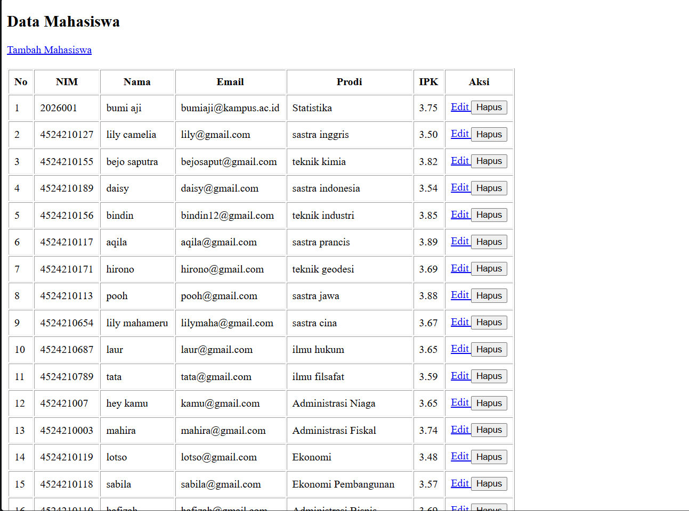
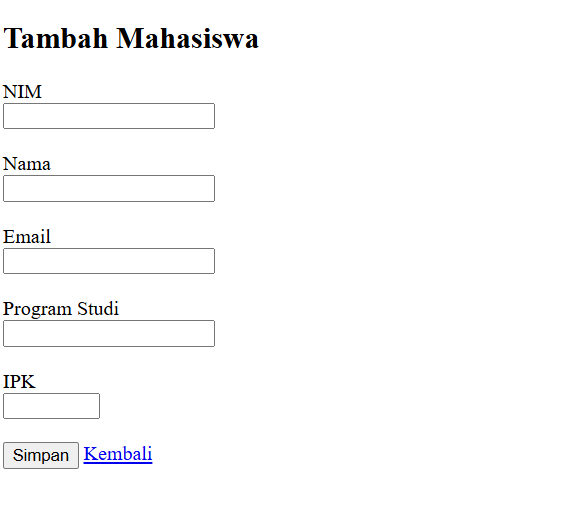
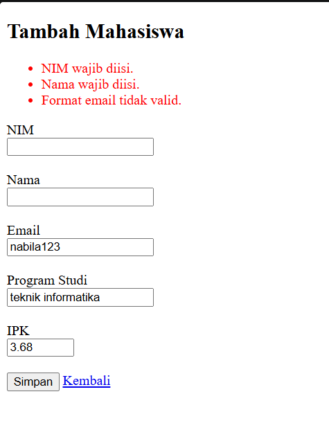
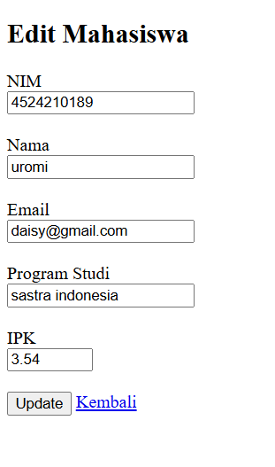

# LAPORAN PRAKTIKUM

## Modul Mahasiswa Menggunakan CodeIgniter 4

**Nama:** Nabila Khoirun Nisaa'  
**NIM:** 4524210116  
**Program Studi:** Teknik Informatika  
**Universitas:** Universitas Pancasila

## 1. Pendahuluan

Pada praktikum ini, saya membuat modul mahasiswa sederhana menggunakan framework CodeIgniter 4. Modul ini dibuat untuk mempelajari cara mengelola data mahasiswa menggunakan konsep CRUD (Create, Read, Update, Delete).

Melalui modul ini, pengguna dapat melihat data mahasiswa, menambahkan data baru, mengubah data yang sudah ada, dan menghapus data mahasiswa. Saya juga menerapkan validasi input agar data yang dimasukkan sesuai dengan ketentuan yang sudah ditentukan.

## 2. Tujuan Praktikum

Tujuan dari praktikum ini adalah:

1. Memahami cara kerja CRUD pada CodeIgniter 4.
2. Mempelajari penggunaan Model dan Controller dalam mengelola data mahasiswa.
3. Menerapkan validasi input menggunakan Validation Rules pada CodeIgniter 4.
4. Menampilkan pesan kesalahan ketika data yang dimasukkan tidak sesuai.
5. Menghubungkan aplikasi dengan database MySQL.

## 3. Implementasi Modul

Pada praktikum ini, saya membuat modul mahasiswa menggunakan CodeIgniter 4 dengan database MySQL bernama `akademik`. Data mahasiswa disimpan dalam tabel `mahasiswa` yang memiliki beberapa field, yaitu NIM, nama, email, program studi, dan IPK.

Modul ini memiliki beberapa fitur yang dapat digunakan untuk mengelola data mahasiswa, yaitu:

- **Daftar Mahasiswa (Read)**, untuk melihat data mahasiswa yang sudah tersimpan di database.
- **Tambah Mahasiswa (Create)**, untuk menambahkan data mahasiswa baru melalui form.
- **Edit Mahasiswa (Update)**, untuk mengubah data mahasiswa yang sudah tersimpan.
- **Hapus Mahasiswa (Delete)**, untuk menghapus data mahasiswa dari database.

## 4. Validasi Input

Pada modul mahasiswa ini, saya menerapkan validasi input pada form tambah dan edit mahasiswa. Validasi digunakan untuk memastikan data yang dimasukkan sudah sesuai dengan ketentuan sebelum disimpan ke database.

Berikut adalah ketentuan validasi yang digunakan:

| Field | Ketentuan |
|---|---|
| NIM | Wajib diisi, 8–15 karakter, dan tidak boleh duplikat |
| Nama | Wajib diisi dan minimal 3 karakter |
| Email | Wajib diisi dan harus menggunakan format email yang valid |
| Program Studi | Wajib diisi |
| IPK | Wajib diisi dengan nilai antara 0 sampai 4 |

Jika pengguna memasukkan data yang tidak sesuai, sistem akan menampilkan pesan kesalahan pada halaman form. Dengan begitu, pengguna dapat mengetahui bagian mana yang perlu diperbaiki. Data yang tidak valid tidak akan disimpan ke dalam database.

## 5. Hasil Implementasi

Setelah modul mahasiswa selesai dibuat, fitur CRUD dapat digunakan untuk mengelola data mahasiswa. Pengguna dapat menambahkan data baru, melihat data yang sudah tersimpan, mengubah data, dan menghapus data mahasiswa.

Validasi input juga dapat berjalan sesuai dengan aturan yang telah dibuat. Ketika terdapat data yang tidak sesuai, sistem akan menampilkan pesan kesalahan sehingga pengguna dapat memperbaiki data tersebut sebelum menyimpannya.

## 6. Dokumentasi Screenshot

### 6.1 Halaman Daftar Mahasiswa

Halaman daftar mahasiswa digunakan untuk melihat data mahasiswa yang sudah tersimpan di database. Pada halaman ini, pengguna juga dapat menambahkan data mahasiswa baru serta melakukan edit dan hapus data.

### 6.2 Halaman Tambah Mahasiswa

Halaman tambah mahasiswa digunakan untuk memasukkan data mahasiswa baru. Pada halaman ini, pengguna mengisi NIM, nama, email, program studi, dan IPK sesuai dengan data yang ingin ditambahkan.

### 6.3 Validasi Input

Pada bagian ini, saya melakukan pengujian validasi dengan memasukkan data yang tidak sesuai dengan ketentuan. Setelah tombol Simpan ditekan, sistem menampilkan pesan kesalahan pada form agar pengguna dapat mengetahui data yang perlu diperbaiki.

### 6.4 Halaman Edit Mahasiswa

Halaman edit mahasiswa digunakan untuk mengubah data mahasiswa yang sudah tersimpan di database. Ketika halaman edit dibuka, form akan menampilkan data mahasiswa sebelumnya sehingga pengguna dapat langsung mengubah informasi yang diperlukan.

## 7. Kesimpulan

Berdasarkan praktikum yang telah dilakukan, saya berhasil membuat modul mahasiswa sederhana menggunakan CodeIgniter 4. Modul ini memiliki fitur CRUD yang dapat digunakan untuk menambah, menampilkan, mengubah, dan menghapus data mahasiswa.

Saya juga mempelajari cara menerapkan validasi input agar data yang dimasukkan sesuai dengan ketentuan. Melalui praktikum ini, saya menjadi lebih memahami penggunaan Model, Controller, View, routing, database, dan Validation Rules dalam pembuatan aplikasi web menggunakan CodeIgniter 4.