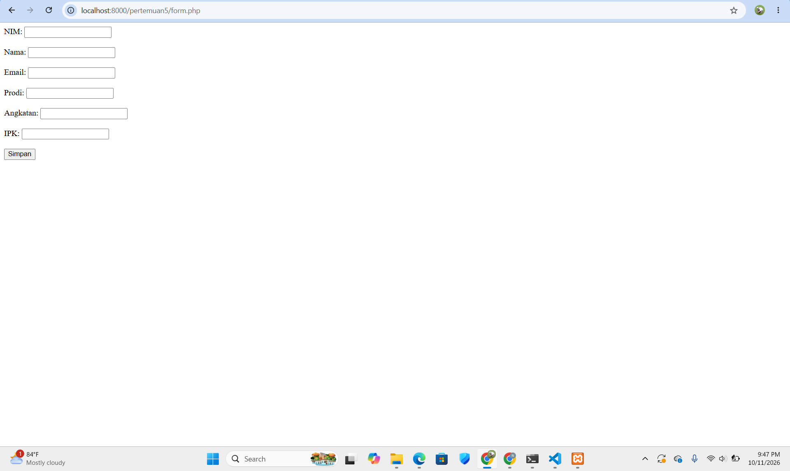
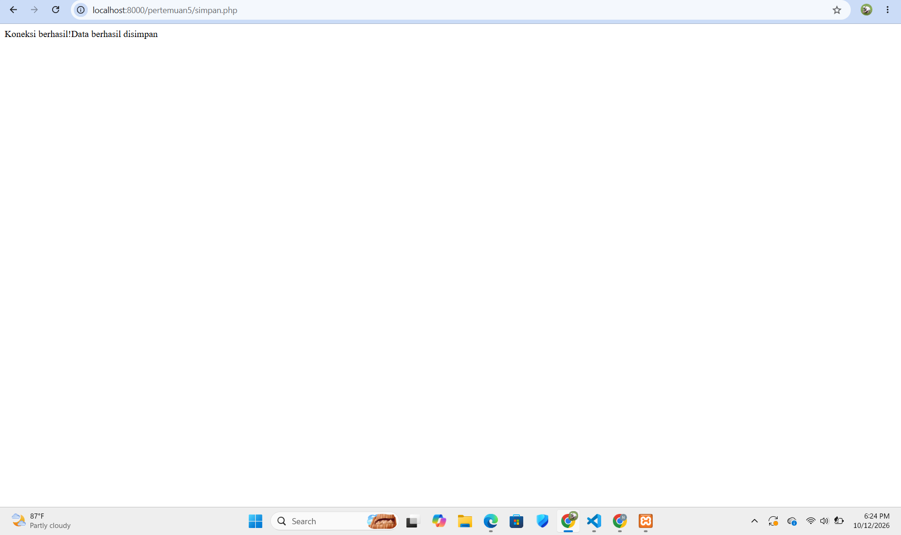
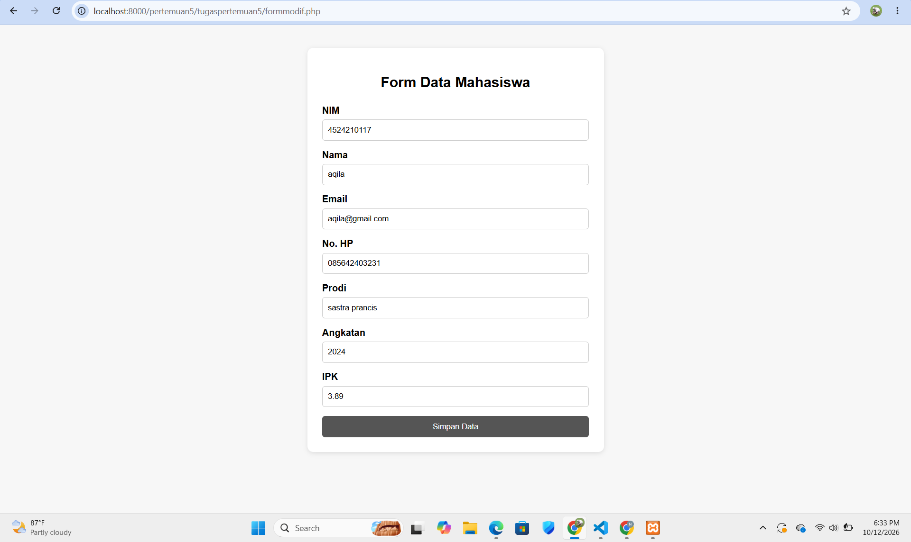
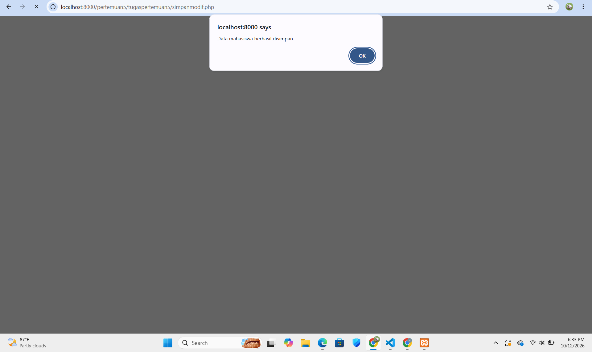

# Tugas 5 Praktikum PBW

**Nama:** Nabila Khoirun Nisaa'  
**NPM:** 4524210116

## 1. Modifikasi Program

Pada tugas ini dilakukan modifikasi pada program **form data mahasiswa** dan proses **penyimpanan data mahasiswa**. File program asli tetap disimpan di folder `pertemuan5`, sedangkan file hasil modifikasi disimpan di folder `tugaspertemuan5`.

### Modifikasi 1 - Form Data Mahasiswa

File `formmodif.php` dibuat dari file `form.php` dengan beberapa perubahan pada tampilan dan validasi input.

Perubahan yang dilakukan:

- Menambahkan tampilan form yang lebih rapi menggunakan CSS sederhana.
- Menambahkan input **No. HP**.
- Menambahkan batas input **No. HP minimal 10 dan maksimal 15 karakter**.
- Menambahkan batas input **angkatan dari 2000 sampai 2100**.
- Menambahkan batas input **IPK dari 0 sampai 4**.
- Menggunakan `step="0.01"` pada input IPK agar dapat menerima angka desimal.
- Mengubah tulisan tombol menjadi **"Simpan Data"**.
- Mengarahkan form ke file `simpanmodif.php` untuk memproses data yang dikirim.

### Modifikasi 2 - Proses Penyimpanan Data

File `simpanmodif.php` dibuat sebagai modifikasi dari proses penyimpanan pada file `simpan.php`.

Perubahan yang dilakukan:

- Menambahkan proses untuk menerima data **No. HP**.
- Menambahkan validasi IPK agar nilainya hanya berada pada rentang **0 sampai 4**.
- Menyesuaikan query `INSERT` agar data No. HP ikut disimpan ke database.
- Menambahkan pesan berhasil atau gagal setelah proses penyimpanan.
- Setelah data berhasil disimpan, halaman akan kembali ke `formmodif.php`.

---

## 2. Penjelasan 5 Bagian Kode Penting

### 1. Form Mengirim Data ke `simpanmodif.php`

```html
<form action="simpanmodif.php" method="post">
```

Kode tersebut digunakan untuk mengirim data yang diisi pada form ke file `simpanmodif.php`.

- `action="simpanmodif.php"` menentukan file yang akan menerima data.
- `method="post"` digunakan untuk mengirim data menggunakan metode POST.

Karena kedua file berada dalam folder `tugaspertemuan5`, tidak perlu menggunakan `../` pada bagian `action`.

### 2. Input No. HP

```html
<label>No. HP</label>
<input type="text" name="no_hp" minlength="10" maxlength="15" required>
```

Kode tersebut digunakan untuk menambahkan data nomor HP pada form.

- `name="no_hp"` digunakan sebagai nama data yang akan dikirim ke PHP.
- `minlength="10"` menentukan minimal jumlah karakter.
- `maxlength="15"` menentukan maksimal jumlah karakter.
- `required` membuat input tidak boleh dikosongkan.

### 3. Validasi IPK

```html
<input type="number" name="ipk" min="0" max="4" step="0.01" required>
```

Kode tersebut digunakan untuk membatasi nilai IPK dari **0 sampai 4**.

Atribut `step="0.01"` memungkinkan pengguna memasukkan nilai IPK dalam bentuk desimal, misalnya `3.75`.

### 4. Validasi IPK pada `simpanmodif.php`

```php
if ($ipk < 0 || $ipk > 4) {
    echo "<script>
            alert('IPK harus berada di antara 0 sampai 4');
            window.history.back();
          </script>";
    exit;
}
```

Kode tersebut digunakan untuk melakukan pengecekan kembali terhadap nilai IPK sebelum data disimpan ke database.

Jika IPK kurang dari 0 atau lebih dari 4, proses penyimpanan dihentikan dan pengguna mendapatkan pesan bahwa IPK harus berada di antara 0 sampai 4.

### 5. Menyimpan Data ke Database

```php
$query = mysqli_query(
    $koneksi,
    "INSERT INTO mahasiswa
    (nim, nama, email, no_hp, prodi, angkatan, ipk)
    VALUES
    ('$nim', '$nama', '$email', '$no_hp', '$prodi', '$angkatan', '$ipk')"
);
```

Kode tersebut digunakan untuk menyimpan data mahasiswa ke tabel `mahasiswa`.

Data yang disimpan meliputi:

- NIM
- Nama
- Email
- No. HP
- Prodi
- Angkatan
- IPK

`mysqli_query()` digunakan untuk menjalankan perintah SQL pada database.

---

## 3. Screenshot Sebelum Modifikasi

### Form Sebelum Modifikasi



### Proses Penyimpanan Sebelum Modifikasi



---

## 4. Screenshot Setelah Modifikasi

### Form Setelah Modifikasi



### Proses Penyimpanan Setelah Modifikasi



> **Catatan:** Nama dan lokasi file screenshot dapat disesuaikan dengan file yang terdapat di repository.

---

## 5. Error yang Pernah Terjadi

### Error

```text
Failed to open stream: No such file or directory
```

### Penyebab

Error tersebut terjadi karena file `formmodif.php` dan `simpanmodif.php` berada di dalam folder `tugaspertemuan5`, sedangkan file `koneksi.php` berada di folder `pertemuan5`.

Ketika file `simpanmodif.php` menggunakan:

```php
include "koneksi.php";
```

PHP akan mencari file `koneksi.php` di dalam folder `tugaspertemuan5`, sehingga file tidak ditemukan.

### Perbaikan

Kode tersebut diubah menjadi:

```php
include "../koneksi.php";
```

Tanda `../` digunakan untuk naik satu folder sehingga PHP dapat menemukan file `koneksi.php` yang berada di folder `pertemuan5`.

---

## 6. Kesimpulan

Pada tugas ini dilakukan modifikasi terhadap form dan proses penyimpanan data mahasiswa. Modifikasi meliputi perubahan tampilan form, penambahan input No. HP, validasi angkatan dan IPK, serta penambahan validasi IPK pada proses penyimpanan.

Selain itu, tugas ini membantu memahami penggunaan `include`, metode `POST`, validasi input HTML, validasi data menggunakan PHP, penggunaan `mysqli_query()` untuk menyimpan data ke database, serta penggunaan path relatif seperti `../` pada PHP.