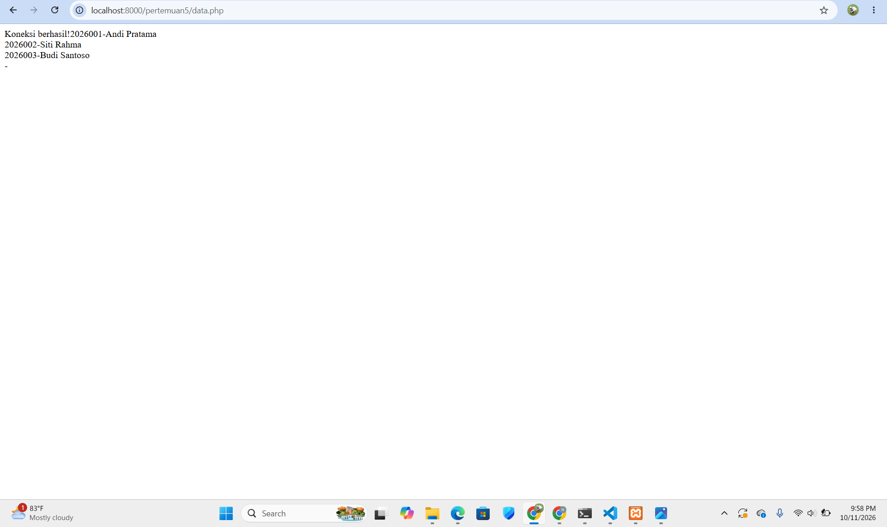
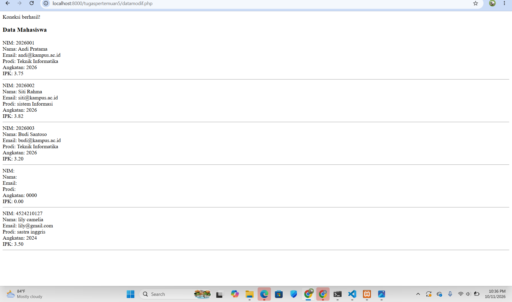

# Tugas 5 Praktikum PBW

**Nama:** Nabila Khoirun Nisaa'  
**NPM:** 4524210116

## 1. Modifikasi Program

Pada tugas ini dilakukan modifikasi pada program **form data mahasiswa** dan **tampilan data mahasiswa**. File program asli tetap disimpan di folder `pertemuan5`, sedangkan file hasil modifikasi disimpan di folder `tugaspertemuan5`.

### Modifikasi 1 - Form Data Mahasiswa

File `formmodif.php` dibuat dari file `form.php` dengan beberapa perubahan pada tampilan dan validasi input.

Perubahan yang dilakukan:

- Menambahkan tampilan form yang lebih rapi menggunakan CSS sederhana.
- Menambahkan batas input **angkatan dari 2000 sampai 2100**.
- Menambahkan batas input **IPK dari 0 sampai 4**.
- Mengubah tulisan tombol menjadi **"Simpan Data"**.
- Mengarahkan form ke file `simpan.php` menggunakan `../simpan.php` karena file modifikasi berada di dalam folder `tugaspertemuan5`.

### Modifikasi 2 - Menampilkan Data Mahasiswa

File `datamodif.php` dibuat dari file `data.php`.

Perubahan yang dilakukan:

- Sebelumnya data yang ditampilkan hanya **NIM dan nama**.
- Setelah dimodifikasi, data yang ditampilkan menjadi **NIM, nama, email, prodi, angkatan, dan IPK**.
- Data ditampilkan dengan format yang lebih lengkap agar lebih mudah dibaca.

---

## 2. Penjelasan 5 Bagian Kode Penting

### 1. Koneksi Database

```php
include "../koneksi.php";
```

Kode tersebut digunakan untuk menghubungkan `datamodif.php` dengan file `koneksi.php`.

Tanda `../` digunakan karena file `datamodif.php` berada satu folder di dalam folder `pertemuan5`, sehingga perlu naik satu tingkat untuk mengakses `koneksi.php`.

### 2. Form Mengirim Data

```php
<form action="../simpan.php" method="post">
```

Kode tersebut digunakan untuk mengirim data yang diisi pada form ke file `simpan.php`.

- `action="../simpan.php"` menentukan file yang akan menerima data.
- `method="post"` digunakan untuk mengirim data menggunakan metode POST.

### 3. Validasi Angkatan

```php
<input type="number" name="angkatan" min="2000" max="2100" required>
```

Kode tersebut digunakan untuk membatasi input angkatan agar berada pada rentang **2000 sampai 2100**.

Atribut `required` digunakan agar input angkatan tidak boleh dikosongkan.

### 4. Validasi IPK

```php
<input type="number" name="ipk" min="0" max="4" step="0.01" required>
```

Kode tersebut digunakan untuk membatasi nilai IPK dari **0 sampai 4**.

Atribut `step="0.01"` memungkinkan pengguna memasukkan nilai IPK dengan angka desimal, misalnya `3.75`.

### 5. Menampilkan Data dari Database

```php
while ($data = mysqli_fetch_assoc($query)) {
    echo "NIM: " . $data['nim'];
    echo "<br>";
    echo "Nama: " . $data['nama'];
}
```

Kode tersebut digunakan untuk mengambil data mahasiswa dari hasil query database dan menampilkannya satu per satu.

`mysqli_fetch_assoc()` mengambil setiap baris data dalam bentuk array dengan nama kolom sebagai indeksnya. Perulangan `while` akan terus berjalan selama masih terdapat data yang dapat ditampilkan.

---

## 3. Screenshot Sebelum Modifikasi

### Form Sebelum Modifikasi


### Data Sebelum Modifikasi



---

## 4. Screenshot Setelah Modifikasi

### Form Setelah Modifikasi


### Data Setelah Modifikasi



> **Catatan:** Nama dan lokasi file screenshot dapat disesuaikan dengan file yang terdapat di repository.

---

## 5. Error yang Pernah Terjadi

### Error

```text
Failed to open stream: No such file or directory
```

### Penyebab

Error tersebut terjadi karena file `datamodif.php` berada di dalam folder `tugaspertemuan5`, sedangkan file `koneksi.php` berada di folder `pertemuan5`.

Ketika menggunakan:

```php
include "koneksi.php";
```

PHP akan mencari file `koneksi.php` di dalam folder `tugaspertemuan5`, sehingga file tidak ditemukan.

### Perbaikan

Kode tersebut diubah dari:

```php
include "koneksi.php";
```

menjadi:

```php
include "../koneksi.php";
```

Tanda `../` digunakan untuk naik satu folder sehingga PHP dapat menemukan file `koneksi.php` yang berada di folder sebelumnya.

---


## 8. Kesimpulan

Pada tugas ini dilakukan modifikasi terhadap program form dan tampilan data mahasiswa. Modifikasi meliputi perubahan tampilan form, penambahan validasi input angkatan dan IPK, serta penambahan data yang ditampilkan pada halaman data mahasiswa.

Selain itu, tugas ini juga membantu memahami penggunaan `include`, metode `POST`, validasi input HTML, pengambilan data dari database menggunakan `mysqli_fetch_assoc()`, serta penggunaan path relatif seperti `../` pada PHP.