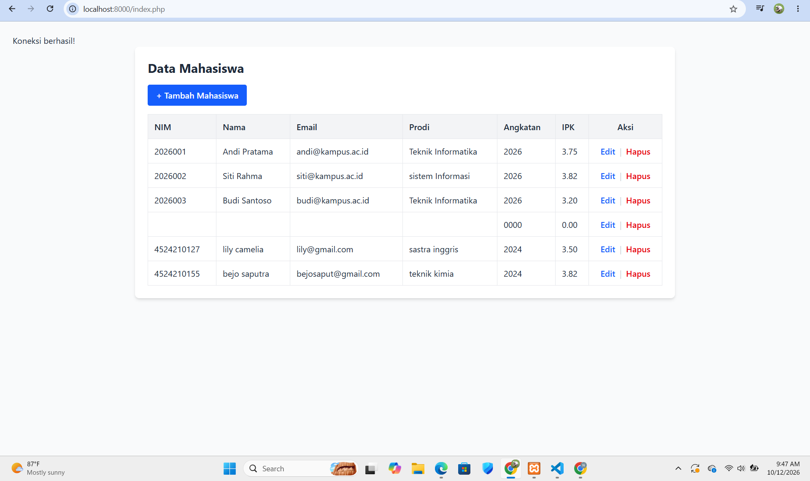
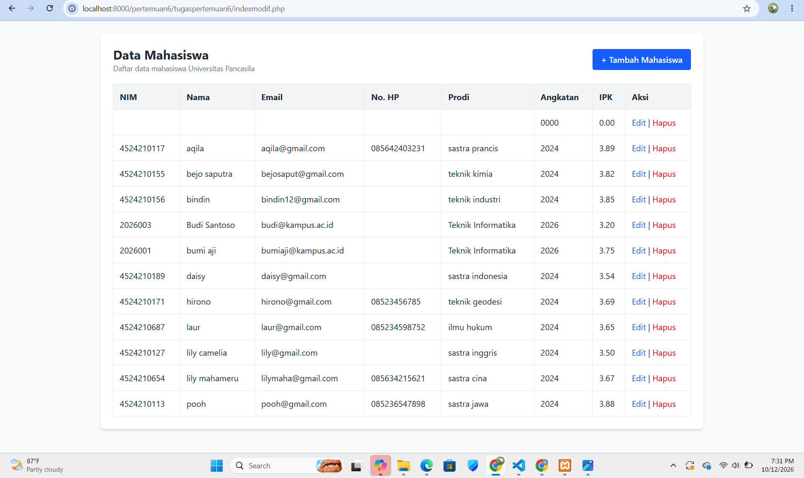
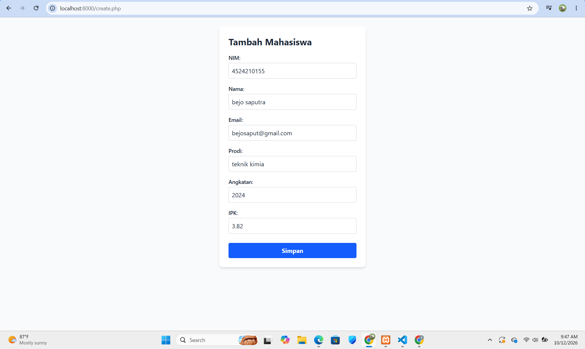
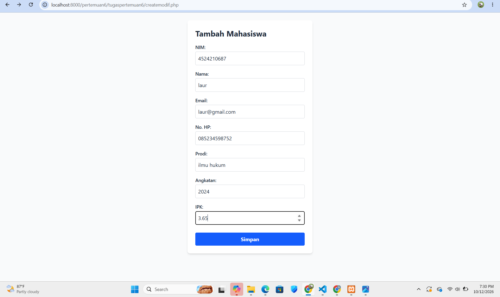
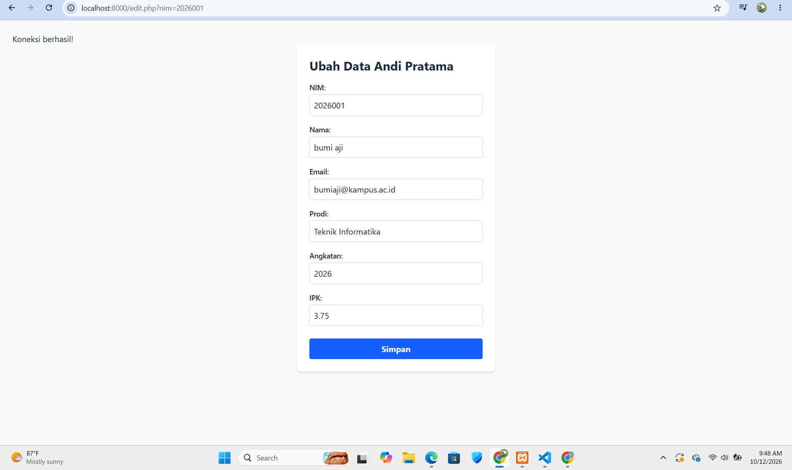
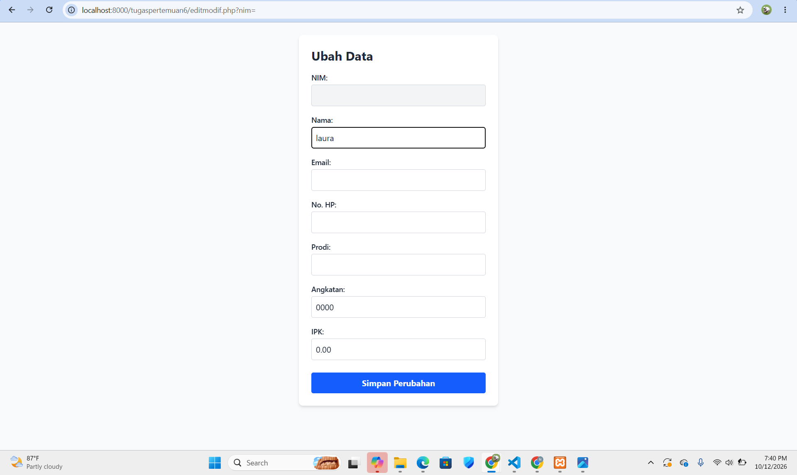

# Tugas 6 Praktikum PBW

**Nama:** Nabila Khoirun Nisaa'  
**NPM:** 4524210116

## 1. Modifikasi Program

Pada tugas ini dilakukan modifikasi pada program CRUD data mahasiswa yang terdapat pada folder `pertemuan6`.

Modifikasi dibuat pada folder `tugaspertemuan6` dengan menggunakan nama file yang berbeda dari program asli agar program asli tetap dapat digunakan sebagai pembanding.


### Modifikasi 1 - Penambahan No. HP

Pada program modifikasi ditambahkan field **No. HP** pada form tambah dan form ubah data mahasiswa.

Field No. HP juga ditampilkan pada halaman data mahasiswa dan disimpan ke dalam database.

Pada input No. HP diberikan validasi panjang karakter, yaitu minimal 10 karakter dan maksimal 15 karakter.

### Modifikasi 2 - Validasi IPK

Ditambahkan validasi pada input IPK agar nilai yang dimasukkan berada pada rentang **0 sampai 4**.

Validasi diterapkan pada proses tambah dan ubah data mahasiswa.

```php
if ($ipk < 0 || $ipk > 4) {
    echo "IPK harus berada di antara 0 sampai 4.";
    exit;
}
```

### Modifikasi 3 - Pengurutan Data

Pada halaman `indexmodif.php`, data mahasiswa ditampilkan berdasarkan nama secara ascending.

```sql
SELECT * FROM mahasiswa ORDER BY nama ASC
```

Dengan demikian, data mahasiswa ditampilkan berdasarkan urutan nama dari A sampai Z.

### Modifikasi 4 - Tampilan Program

Tampilan program dibuat lebih rapi dengan menambahkan styling pada halaman index, create, dan edit.

Beberapa perubahan yang dilakukan yaitu:

- Membuat form lebih terstruktur.
- Menambahkan tabel untuk menampilkan data.
- Menambahkan tombol tambah mahasiswa.
- Menambahkan tombol Edit dan Hapus.
- Menampilkan field No. HP pada tabel.
- Menambahkan tampilan yang lebih sederhana dan mudah digunakan.

---

## 2. Penjelasan 5 Bagian Kode Penting

### 1. Koneksi Database

Pada `koneksimodif.php` digunakan untuk menghubungkan program dengan database `akademik`.

```php
$koneksi = mysqli_connect($host, $user, $pass, $db);

if (!$koneksi) {
    die("Koneksi gagal: " . mysqli_connect_error());
}

mysqli_set_charset($koneksi, "utf8mb4");
```

Kode tersebut digunakan agar program dapat melakukan proses tambah, tampil, ubah, dan hapus data pada database.

### 2. Menampilkan Data Mahasiswa

Pada `indexmodif.php` digunakan query untuk mengambil data mahasiswa dari database.

```php
$query = mysqli_query(
    $koneksi,
    "SELECT * FROM mahasiswa ORDER BY nama ASC"
);
```

Data kemudian ditampilkan menggunakan perulangan `while`.

```php
while ($data = mysqli_fetch_assoc($query)) {
```

Perulangan tersebut digunakan untuk mengambil dan menampilkan setiap data mahasiswa dari hasil query.

### 3. Menambahkan Data Mahasiswa

Pada `storemodif.php`, data yang dikirim dari `createmodif.php` diterima menggunakan `$_POST`.

```php
$nim = $_POST['nim'];
$nama = $_POST['nama'];
$email = $_POST['email'];
$no_hp = $_POST['no_hp'];
$prodi = $_POST['prodi'];
$angkatan = $_POST['angkatan'];
$ipk = $_POST['ipk'];
```

Data tersebut kemudian dimasukkan ke dalam tabel `mahasiswa`.

### 4. Validasi IPK dan No. HP

Sebelum data disimpan atau diubah, dilakukan validasi terhadap IPK dan No. HP.

```php
if ($ipk < 0 || $ipk > 4) {
    echo "IPK harus berada di antara 0 sampai 4.";
    exit;
}
```

Untuk No. HP digunakan:

```php
if (strlen($no_hp) < 10 || strlen($no_hp) > 15) {
    echo "No. HP harus terdiri dari 10 sampai 15 karakter.";
    exit;
}
```

Validasi ini digunakan agar data yang dimasukkan sesuai dengan ketentuan yang telah dibuat.

### 5. Mengubah Data Mahasiswa

Pada `updatemodif.php`, data mahasiswa yang dipilih akan diperbarui menggunakan query `UPDATE`.

```php
$query = mysqli_query(
    $koneksi,
    "UPDATE mahasiswa
    SET
        nama = '$nama',
        email = '$email',
        no_hp = '$no_hp',
        prodi = '$prodi',
        angkatan = '$angkatan',
        ipk = '$ipk'
    WHERE nim = '$nim'"
);
```

Setelah data berhasil diubah, halaman akan diarahkan kembali ke `indexmodif.php`.

---

## 3. Screenshot Hasil Program

Screenshot yang digunakan dalam laporan terdiri dari **6 screenshot**, yaitu halaman Index, Create, dan Edit sebelum serta sesudah modifikasi.

### A. Halaman Index

#### Sebelum Modifikasi

Screenshot halaman `index.php` sebelum dilakukan modifikasi.



#### Sesudah Modifikasi

Screenshot halaman `indexmodif.php` setelah dilakukan modifikasi.



Perubahan yang terlihat antara lain penambahan kolom No. HP, pengurutan data berdasarkan nama, serta tampilan tabel dan tombol aksi yang dibuat lebih rapi.

---

### B. Halaman Create

#### Sebelum Modifikasi

Screenshot halaman `create.php` sebelum dilakukan modifikasi.



#### Sesudah Modifikasi

Screenshot halaman `createmodif.php` setelah dilakukan modifikasi.



Perubahan yang dilakukan yaitu penambahan input No. HP serta validasi pada input IPK dan No. HP.

---

### C. Halaman Edit

#### Sebelum Modifikasi

Screenshot halaman `edit.php` sebelum dilakukan modifikasi.



#### Sesudah Modifikasi

Screenshot halaman `editmodif.php` setelah dilakukan modifikasi.



Perubahan yang dilakukan yaitu penambahan field No. HP serta validasi IPK dan No. HP pada form ubah data.

---

## 4. Error yang Ditemukan

### Error 1 - File Koneksi Tidak Ditemukan

Saat menjalankan proses ubah data, sempat muncul error:

```text
Warning: include(koneksi.php): Failed to open stream:
No such file or directory
```

Error tersebut terjadi karena `updatemodif.php` masih memanggil file `koneksi.php`, sedangkan program modifikasi menggunakan file `koneksimodif.php`.

Perbaikannya dilakukan dengan mengubah:

```php
include "koneksi.php";
```

menjadi:

```php
include "koneksimodif.php";
```

Setelah diperbaiki, koneksi database dapat digunakan kembali oleh `updatemodif.php`.

---


## 5. Kesimpulan

Pada tugas ini dilakukan modifikasi pada program CRUD data mahasiswa dengan menambahkan field No. HP, validasi IPK dan No. HP, pengurutan data berdasarkan nama, serta perubahan tampilan pada beberapa halaman.

Program modifikasi tetap memiliki fungsi utama untuk menampilkan, menambahkan, mengubah, dan menghapus data mahasiswa. Modifikasi tersebut dilakukan tanpa mengubah program asli sehingga hasil program sebelum dan sesudah modifikasi dapat dibandingkan.