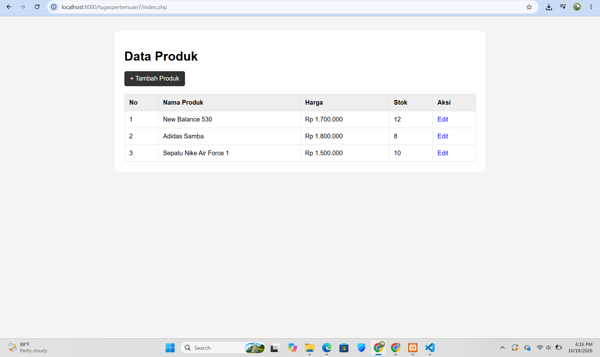
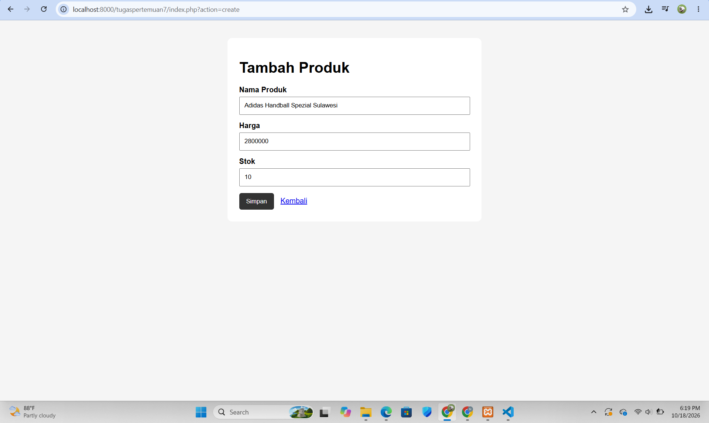
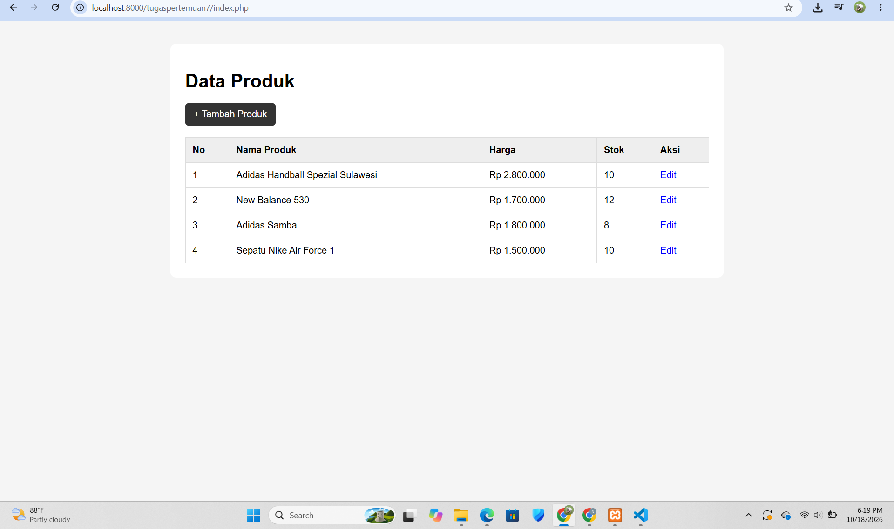
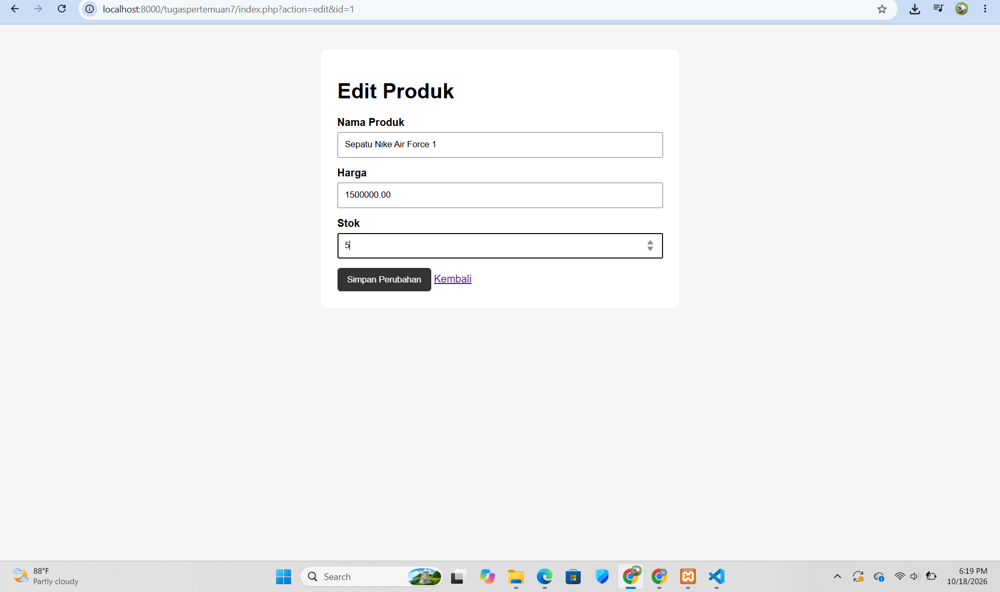
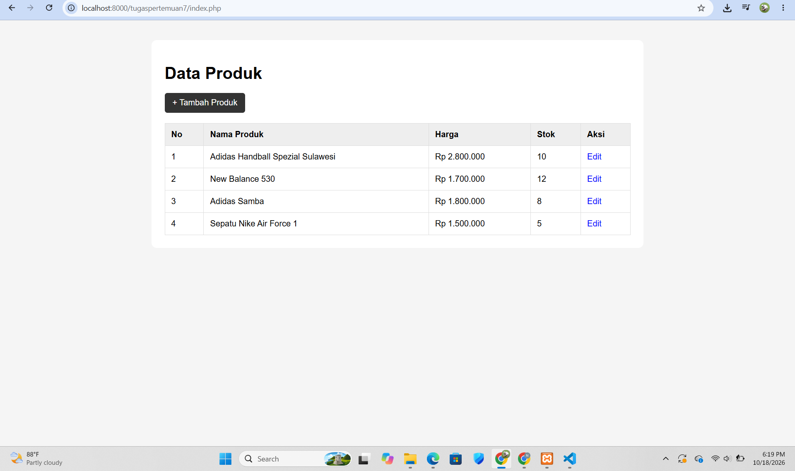
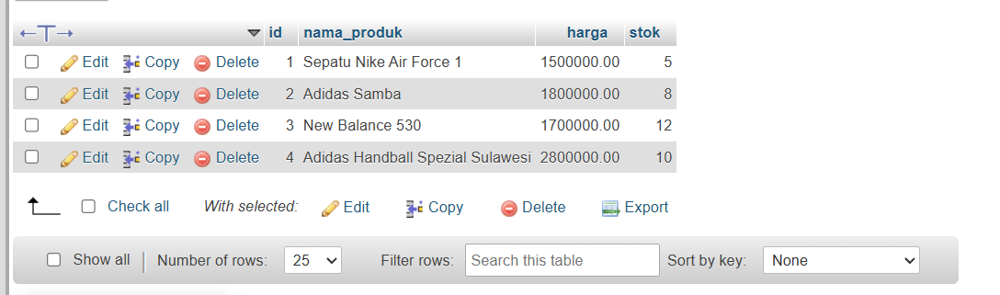

# Tugas 7 Praktikum PBW

**Nama:** Nabila Khoirun Nisaa'  
**NPM:** 4524210116

## 1. Konsep MVC

Pada Tugas 7 dibuat program penjualan produk sederhana menggunakan konsep **MVC (Model, View, Controller)** dan database MySQL.

MVC digunakan untuk memisahkan bagian program berdasarkan fungsinya, yaitu:

- **Model** digunakan untuk mengelola data dan berinteraksi dengan database.
- **View** digunakan untuk menampilkan halaman kepada pengguna.
- **Controller** digunakan untuk mengatur alur program dan menghubungkan Model dengan View.

## 2. Struktur Folder

Struktur folder yang dibuat sesuai dengan konsep MVC adalah:

```text
tugaspertemuan7
├── controllers
│   └── ProdukController.php
├── models
│   └── ProdukModel.php
├── views
│   └── produk
│       ├── create.php
│       ├── edit.php
│       └── index.php
├── index.php
└── koneksi.php
```

Penjelasan masing-masing file:

- `ProdukController.php` digunakan untuk mengatur proses program dan menghubungkan Model dengan View.
- `ProdukModel.php` digunakan untuk mengelola data produk dan menjalankan query ke database.
- `create.php` digunakan untuk menampilkan form tambah produk.
- `edit.php` digunakan untuk menampilkan form edit produk.
- `index.php` pada folder `views/produk` digunakan untuk menampilkan daftar produk.
- `index.php` pada folder utama digunakan sebagai pintu masuk utama program.
- `koneksi.php` digunakan untuk menghubungkan program dengan database MySQL.

## 3. Program yang Dibuat

Program yang dibuat merupakan program penjualan produk sederhana.

Program memiliki beberapa fungsi utama, yaitu:

1. Menampilkan daftar produk.
2. Menambahkan produk baru.
3. Mengedit data produk.
4. Menyimpan perubahan data produk.
5. Menampilkan data produk yang tersimpan di database.

Data produk yang digunakan terdiri dari:

- Nama produk
- Harga
- Stok

## 4. Database

Database yang digunakan bernama `penjualan_mvc`.

Tabel yang digunakan adalah tabel `produk` dengan struktur:

```sql
CREATE DATABASE penjualan_mvc;

USE penjualan_mvc;

CREATE TABLE produk (
    id INT AUTO_INCREMENT PRIMARY KEY,
    nama_produk VARCHAR(100) NOT NULL,
    harga DECIMAL(12,2) NOT NULL,
    stok INT NOT NULL
);
```

Contoh data produk:

```sql
INSERT INTO produk (nama_produk, harga, stok) VALUES
('Sepatu Nike Air Force 1', 1500000, 10),
('Adidas Samba', 1800000, 8),
('New Balance 530', 1700000, 12);
```

Data yang dimasukkan melalui program akan tersimpan pada tabel `produk` dan dapat ditampilkan kembali pada halaman daftar produk.

## 5. Alur Program MVC

Alur program dimulai dari `index.php` yang berada pada folder `tugaspertemuan7`.

```text
index.php
    ↓
ProdukController.php
    ↓
ProdukModel.php
    ↓
Database MySQL
    ↓
ProdukController.php
    ↓
View
```

Contohnya ketika menambahkan produk:

```text
create.php
    ↓
ProdukController.php
    ↓
ProdukModel.php
    ↓
Database
    ↓
index.php
```

Sedangkan ketika mengedit produk:

```text
index.php
    ↓
edit.php
    ↓
ProdukController.php
    ↓
ProdukModel.php
    ↓
Database
    ↓
index.php
```

## 6. Screenshot Hasil Program

### A. Halaman Daftar Produk

Screenshot halaman utama yang menampilkan daftar produk.




### B. Halaman Tambah Produk

Screenshot halaman form untuk menambahkan produk.




### C. Hasil Penambahan Produk

Screenshot setelah data produk berhasil ditambahkan dan ditampilkan pada halaman daftar produk.




### D. Halaman Edit Produk

Screenshot halaman untuk mengubah data produk.




### E. Hasil Perubahan Data

Screenshot setelah data produk berhasil diperbarui.




### F. Database

Screenshot tabel `produk` pada phpMyAdmin yang menunjukkan data yang tersimpan.




## 7. Kesimpulan

Pada Tugas 7 telah dibuat program penjualan produk sederhana menggunakan konsep MVC. Program terdiri dari Model, View, dan Controller yang memiliki fungsi masing-masing.

Program dapat digunakan untuk menampilkan, menambahkan, dan mengedit data produk. Data produk juga terhubung dengan database MySQL sehingga data yang dimasukkan melalui program dapat disimpan dan ditampilkan kembali.