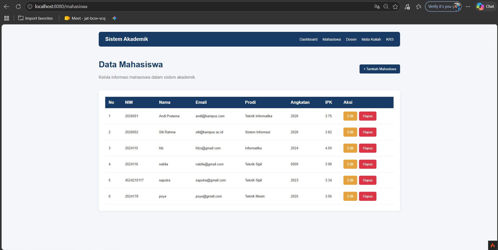
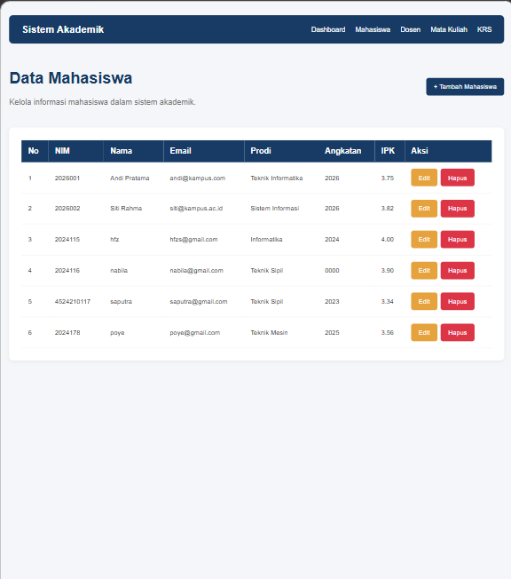
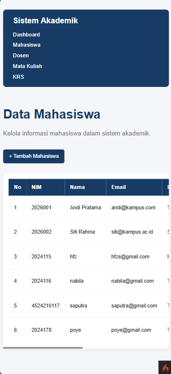

# SISTEM INFORMASI AKADEMIK
## Implementasi Responsive Web Design

## 1. Deskripsi Proyek

Sistem Informasi Akademik merupakan aplikasi berbasis web yang dikembangkan untuk membantu proses pengelolaan data akademik secara terkomputerisasi.

Aplikasi ini dibangun menggunakan framework CodeIgniter 4 dengan database MySQL. Sistem menyediakan fitur pengelolaan data mahasiswa, dosen, mata kuliah, dan Kartu Rencana Studi (KRS).

Selain itu, aplikasi dikembangkan dengan konsep Responsive Web Design agar tampilan dapat menyesuaikan berbagai ukuran layar perangkat, baik desktop, tablet, maupun smartphone.

## 2. Tujuan Pengembangan

1. Mempermudah pengelolaan informasi akademik.
2. Mengembangkan sistem informasi akademik berbasis web.
3. Menerapkan Responsive Web Design.
4. Menyesuaikan tampilan aplikasi dengan ukuran layar perangkat.
5. Memberikan pengalaman penggunaan yang nyaman pada berbagai perangkat.

## 3. Fitur Sistem

### A. Dashboard
- Menampilkan jumlah mahasiswa.
- Menampilkan jumlah dosen.
- Menampilkan jumlah mata kuliah.
- Menampilkan jumlah KRS.
- Menyediakan navigasi menuju setiap halaman pengelolaan data.

### B. Data Mahasiswa
- Menampilkan data mahasiswa.
- Menambahkan data mahasiswa.
- Mengedit data mahasiswa.
- Menghapus data mahasiswa.
- Mengelola NIM, nama, email, program studi, angkatan, dan IPK.

### C. Data Dosen
- Mengelola data dosen.

### D. Data Mata Kuliah
- Mengelola data mata kuliah.

### E. Data KRS
- Mengelola data Kartu Rencana Studi mahasiswa.

## 4. Teknologi yang Digunakan

| Teknologi | Keterangan |
|---|---|
| PHP | Bahasa pemrograman |
| CodeIgniter 4 | Framework aplikasi |
| MySQL | Database |
| HTML | Struktur halaman |
| CSS | Desain dan responsivitas |
| XAMPP | Web server lokal |
| Visual Studio Code | Code editor |

## 5. Implementasi Responsive Web Design

Responsive Web Design merupakan pendekatan desain web yang memungkinkan tampilan aplikasi menyesuaikan ukuran layar perangkat yang digunakan.

Pada proyek ini, pengujian dilakukan menggunakan tiga jenis perangkat:

1. Desktop dengan ukuran layar 1366 × 768 piksel.
2. Tablet dengan ukuran layar 768 × 1024 piksel.
3. Smartphone dengan ukuran layar 375 × 812 piksel.

Pengaturan responsivitas dilakukan menggunakan CSS Media Queries agar tata letak halaman dapat menyesuaikan ukuran layar.

## 6. Hasil Visualisasi Tampilan

### A. Tampilan Desktop

**Ukuran layar: 1366 × 768 piksel**

**Screenshot Tampilan Desktop:**



**Penjelasan:**

Pada tampilan desktop, aplikasi ditampilkan melalui layar komputer atau laptop. Area layar yang luas memungkinkan navigasi, kartu informasi Dashboard, dan konten halaman ditampilkan secara lebih leluasa.

Informasi jumlah mahasiswa, dosen, mata kuliah, dan KRS dapat ditampilkan dalam susunan kartu yang teratur sehingga pengguna lebih mudah melihat ringkasan informasi akademik.

### B. Tampilan Tablet

**Ukuran layar: 768 × 1024 piksel**

**Screenshot Tampilan Tablet:**



**Penjelasan:**

Pada tampilan tablet, ukuran elemen dan susunan halaman menyesuaikan ruang layar yang lebih kecil dibandingkan desktop.

Kartu Dashboard disusun agar tetap mudah dibaca, sedangkan navigasi menyesuaikan ruang yang tersedia. Penyesuaian ini bertujuan agar pengguna tetap dapat mengakses fitur sistem tanpa tampilan yang saling bertumpuk.

### C. Tampilan Smartphone

**Ukuran layar: 375 × 812 piksel**

**Screenshot Tampilan Smartphone:**



**Penjelasan:**

Pada tampilan smartphone, aplikasi menggunakan tata letak yang lebih sederhana dan vertikal agar sesuai dengan ukuran layar ponsel.

Kartu informasi Dashboard disusun secara vertikal, navigasi menyesuaikan lebar layar, dan tabel data dapat digeser secara horizontal apabila ukurannya melebihi layar.

Dengan penyesuaian tersebut, pengguna dapat mengakses sistem melalui smartphone dengan lebih nyaman.

## 7. Perbandingan Tampilan Antarperangkat

| Aspek | Desktop | Tablet | Smartphone |
|---|---|---|---|
| Ukuran layar | 1366 × 768 | 768 × 1024 | 375 × 812 |
| Navigasi | Horizontal | Menyesuaikan layar | Vertikal |
| Kartu Dashboard | Susunan beberapa kolom | Dua kolom | Satu kolom |
| Konten | Lebar | Menyesuaikan layar | Vertikal |
| Tabel | Tampilan normal | Menyesuaikan | Dapat digeser |
| Penggunaan | Laptop/komputer | Tablet | Ponsel |

## 8. Pengujian Responsivitas

Pengujian dilakukan menggunakan fitur Responsive Design Mode pada browser Google Chrome atau Microsoft Edge.

Tahapan pengujian:

1. Menjalankan aplikasi Sistem Informasi Akademik.
2. Membuka aplikasi melalui browser.
3. Menekan tombol F12 untuk membuka Developer Tools.
4. Mengaktifkan Toggle Device Toolbar.
5. Mengatur ukuran layar desktop, tablet, dan smartphone.
6. Mengamati perubahan tata letak pada setiap ukuran layar.
7. Memastikan navigasi, kartu Dashboard, tabel, dan tombol tetap dapat digunakan.

### Tabel Hasil Pengujian

| No. | Aspek Pengujian | Desktop | Tablet | Smartphone |
|---|---|---|---|---|
| 1 | Tampilan Dashboard | Diisi setelah pengujian | Diisi setelah pengujian | Diisi setelah pengujian |
| 2 | Navigasi menu | Diisi setelah pengujian | Diisi setelah pengujian | Diisi setelah pengujian |
| 3 | Tampilan kartu | Diisi setelah pengujian | Diisi setelah pengujian | Diisi setelah pengujian |
| 4 | Tampilan tabel | Diisi setelah pengujian | Diisi setelah pengujian | Diisi setelah pengujian |
| 5 | Tombol dan formulir | Diisi setelah pengujian | Diisi setelah pengujian | Diisi setelah pengujian |

## 9. Struktur Folder Dokumentasi

Screenshot hasil pengujian disimpan dalam folder `screenshots` pada direktori utama proyek.

```text
Sistem-Informasi-Akademik/
│
├── app/
├── public/
│   └── css/
│       └── style.css
│
├── screenshots/
│   ├── desktop.png
│   ├── tablet.png
│   └── smartphone.png
│
├── writable/
├── tests/
├── .env
├── composer.json
└── README.md
```

**Ketentuan screenshot:**
- `dekstop.png` merupakan hasil screenshot tampilan desktop.
- `tablet.png` merupakan hasil screenshot tampilan tablet.
- `smartphone.png` merupakan hasil screenshot tampilan smartphone.

Pastikan ketiga gambar merupakan screenshot asli dari aplikasi yang telah dijalankan, bukan gambar contoh atau ilustrasi.

## 10. Tim Pengembang

| No. | Nama Anggota | NPM |
|---|---|---|
| 1 | Muhammad Hafiz Saputra | 4524210115 |
| 2 | Nabila Khoirun Nisaa' | 4524210116 |
| 3 | Zoeffanya Cianda L.A | 4524210106 |
| 4 | Syalva Kirania Kresti | 4524210101 |

## 11. Kesimpulan

Berdasarkan pengembangan Sistem Informasi Akademik, penerapan Responsive Web Design bertujuan agar aplikasi dapat digunakan pada berbagai perangkat dengan ukuran layar yang berbeda.

Pengujian dilakukan pada tiga jenis tampilan, yaitu desktop, tablet, dan smartphone. Melalui pengujian tersebut, dapat diamati penyesuaian tata letak, navigasi, kartu Dashboard, serta tabel agar tetap mudah digunakan.

Dengan penerapan desain responsif, Sistem Informasi Akademik diharapkan dapat memberikan kemudahan akses dan pengalaman penggunaan yang lebih baik bagi pengguna.

---

**SISTEM INFORMASI AKADEMIK**  
Framework: CodeIgniter 4  
Database: MySQL
